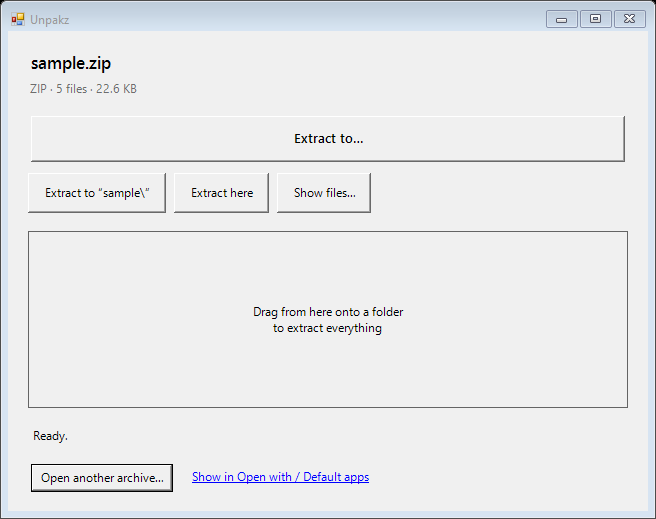
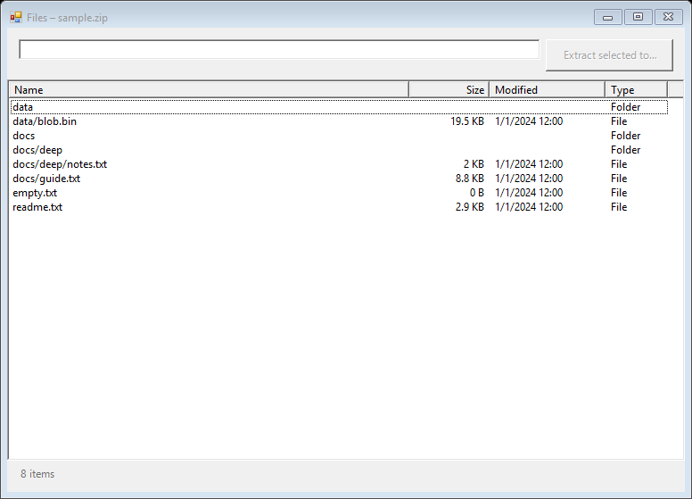

# unpakz

> **Experimental (v0.2.0).** Written test-first with AI assistance as a harness-engineering exercise. Tested on Windows 11 and on
> Linux/WSL by automated tests only; no field use. Real drag-and-drop into Explorer has **not** been observed working (see
> [Known limitations](#known-limitations)). Review the code before trusting it with anything important: archive extraction is a
> security boundary.

An extraction-only archive tool for **Windows 11**: ZIP / ZIP64 (including archives and entries over 2 GiB), tar.gz, RAR 4 and RAR 5.
It does not create archives. Windows already ships `tar.exe`; what this adds is a hostile-input guard, no double write, a file list
with selection and drag-out, RAR, and big archives.

## Architecture

```
Unpakz.exe (WinForms)  unpakz.exe (CLI)          .NET Framework 4.8: in the box on Windows 11, nothing to install
        \               /
         Unpakz.Interop + Unpakz.Presentation    netstandard2.0: P/Invoke layer, view-models
                  |
            unpakz_native.dll                    C++ (MSVC, static CRT): all archive logic
        guard + limits + single-write sink       <- authoritative; the managed side only re-checks names it shows
        libarchive 3.8.11 (zip, tar.gz, RAR4)  +  our RAR5 reader (solid, filters, multi-volume, BLAKE2sp)  +  zlib-ng
```

The C API is seven functions (`native/include/unpakz.h`): list, extract, stream one entry (for drag-out), check a name, defaults, versions.

## What it does

* **Formats**: ZIP/ZIP64 (stored, deflate), tar.gz / .tgz, RAR 4, RAR 5 (stored and methods 1-5, solid, delta/x86/ARM filters,
  multi-part sets `name.part1.rar …`, CRC-32 and BLAKE2sp). Encrypted archives are refused with a clear message.
* **No temporary folder.** Each file is decoded straight into a hidden temp *file* in its destination folder and renamed when its size
  and checksum check out, so every byte is written once. A failed file leaves nothing behind. Dragging files out hands Explorer a
  stream of decoded bytes instead of extracting to a scratch folder first.
* **Refuses hostile archives before writing anything**: `..` traversal, absolute / UNC / drive paths, reserved device names (`CON`,
  `NUL.txt`, `COM¹` …), alternate data streams, trailing dots, case collisions, file/folder collisions, links and special files
  (skipped and reported, never created), entry-count / size / dictionary limits, and existing files (it asks first).
* **Windows app**: open or drop an archive; *Extract to…* (folder picker), *Extract to “name\”*, *Extract here*; a **file list** with
  search, sort, multi-select (picking a folder takes its contents) and *Extract selected to…*; drag either onto an Explorer folder.
  Progress and cancel. Optional registration in *Open with* / *Default apps* (per user, no admin).
* **Command line** (`unpakz.exe`): `l` list, `t` test (decode everything, write nothing), `x` extract (all or named paths; `-o`, `--here`,
  `--skip`, `--overwrite`).

 

## Install and use

Windows 11 x64. No runtime to install.

1. Download `unpakz-app-win-x64.zip` from the release page and unzip it anywhere (keep the files together).
2. Run `Unpakz.exe`, then drop an archive on the window, or use *Open another archive…*.
   `Unpakz.exe path\to\file.zip` opens it directly; so does choosing Unpakz in *Open with*.
3. Optional: *Show in Open with / Default apps* (bottom of the window), then pick Unpakz for `.zip` / `.rar` / `.tgz` in Windows Settings.

The executables are not code-signed, so SmartScreen will warn on first run.

Command line (`unpakz.exe` from `unpakz-cli-win-x64.zip`):

```
unpakz l backup.zip                     list
unpakz t set.part1.rar                  test a multi-part RAR set (all parts in one folder)
unpakz x backup.zip -o D:\restore       extract
unpakz x backup.zip docs readme.txt     extract only these paths (a folder takes its contents)
```

Exit codes: 0 ok, 1 error (message explains), 2 usage, 130 cancelled.

## How it is verified

The verification harness is the main deliverable. See **[HARNESS.md](HARNESS.md)** and **[docs/STATUS.md](docs/STATUS.md)** for the numbers.

* Native code: 7 test programs under AddressSanitizer + UBSan on WSL and under MSVC on Windows; a 210-mutant catalogue (every mutant
  killed or listed as equivalent with its reason); a 5 GiB ZIP64 entry; corruption sweeps (every byte flip and truncation of real archives:
  a typed error or the exact original bytes).
* Differential conformance against `unrar`, 7-Zip and `tar` on committed fixtures, freshly generated archives and 102 third-party RAR
  vectors (including libarchive's security regressions).
* Managed code: 68 tests over the real native library (Linux and Windows) and 21 Windows tests on .NET Framework 4.8: COM data object,
  registry, and the real windows rendered at 4 font scales × 3 sizes in 5 states with real button clicks.

## Known limitations

* **Drag-and-drop into Explorer is unverified.** The data object is tested through its COM interfaces; injected mouse input could not
  start a drag on the test machine, so no drop was observed. *Extract to…* is the verified path.
* Not supported: encrypted archives, RAR entries without any checksum, self-extracting stubs, split ZIP, tar.bz2/xz/zstd, plain `.gz`.
* ZIP names without an encoding flag are read as UTF-8; old archives in an OEM code page are refused rather than guessed.
* RAR 4 goes through libarchive; one VM-filter edge case that `unrar` handles is refused. RAR 4 archives could not be generated here
  (`rar` 7.x dropped `-ma4`), so RAR 4 is covered by third-party vectors only.
* Performance is not tuned beyond zlib-ng's SIMD; there are no benchmarks of the new backend yet. I/O will usually dominate.
* The file list has no "packed size" column (the native library does not report it).
* Windows-specific path rules (junctions, 8.3 names) rely on the guard plus the check for links in the destination path.

## Layout

| Path | Role |
|---|---|
| `native/` | the C++ backend: `src/` (guard, engine, RAR5, sink, C API), `tests/`, `include/unpakz.h` |
| `third_party/` | vendored libarchive and zlib-ng (see [docs/THIRD-PARTY.md](docs/THIRD-PARTY.md)) |
| `src/Unpakz.Interop` | P/Invoke wrapper and UI-support logic (selection, naming, errors, drag list, entry stream) |
| `src/Unpakz.Presentation` | view-models for both windows (UI-free, testable) |
| `src/Unpakz.Cli`, `src/Unpakz.App`, `src/Unpakz.Windows` | the command line, the WinForms windows, the COM drag source and registry code |
| `tests/`, `harness/`, `scripts/`, `HARNESS.md` | the verification harness |
| `docs/decisions/` | why things are the way they are |

## Build and test

```
./harness.sh fast        # WSL: native library (optimised) + its tests, then the managed layers over it
./harness.sh native      # WSL: native tests under AddressSanitizer + UBSan
.\harness.ps1 fast       # Windows: MSVC native build + tests, then the managed projects and the UI tests
.\scripts\package.ps1    # Windows: the release zips in artifacts\
```

Windows needs Visual Studio Build Tools (MSVC, CMake, Ninja) and the .NET SDK.

## Credits and licence

BSD-2-Clause, © 2026 Jean-Francois Bobier — see [LICENSE](LICENSE). Built on libarchive (BSD-2-Clause, several files under other permissive
licences) and zlib-ng (zlib licence); the RAR 5 algorithm follows libarchive's reader. Details in [docs/THIRD-PARTY.md](docs/THIRD-PARTY.md).
No RARLAB or 7-Zip RAR source was used.
